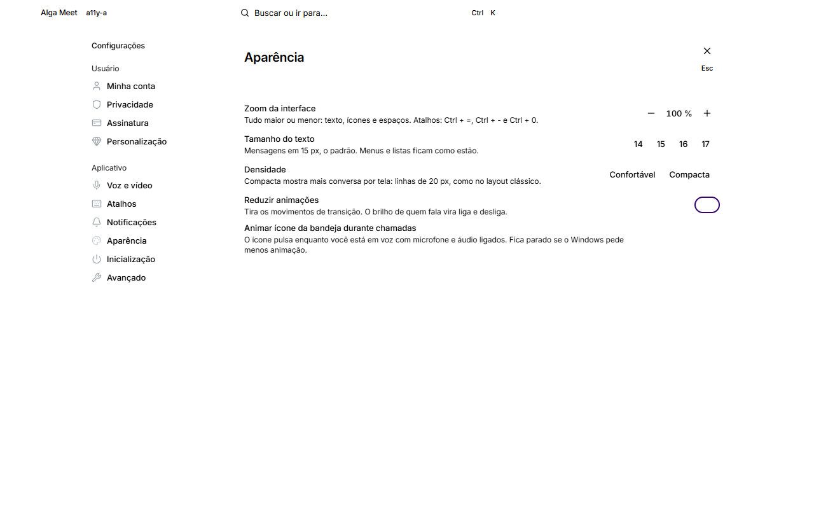
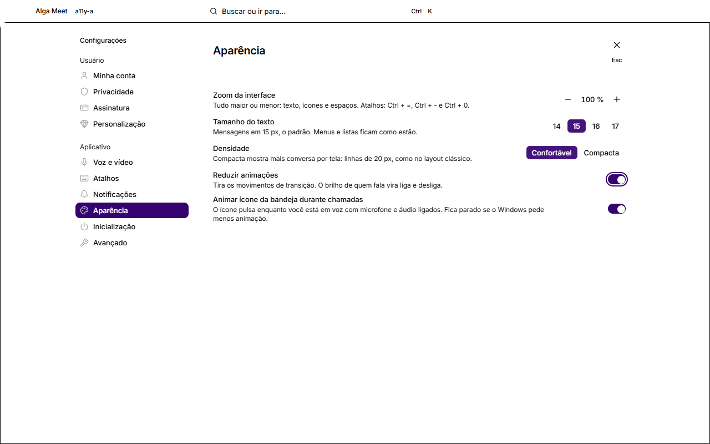
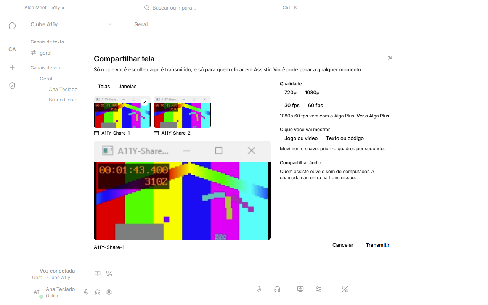
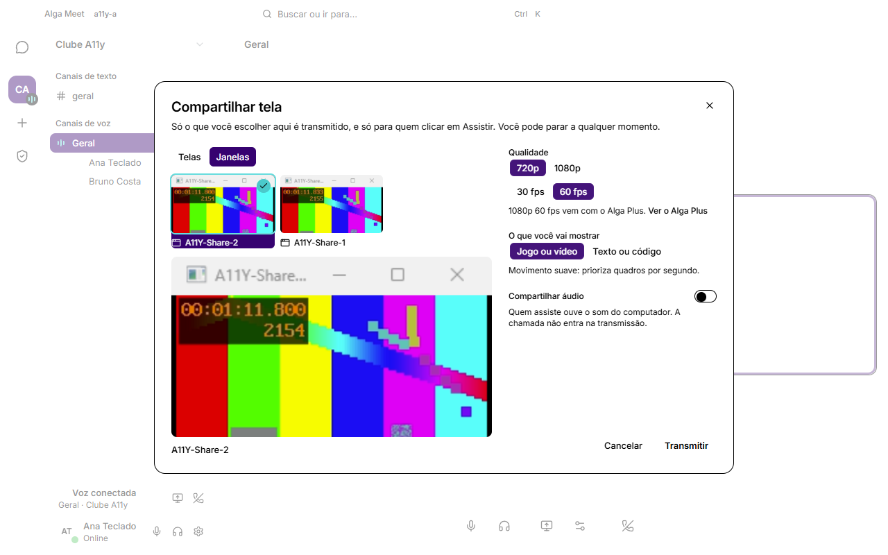
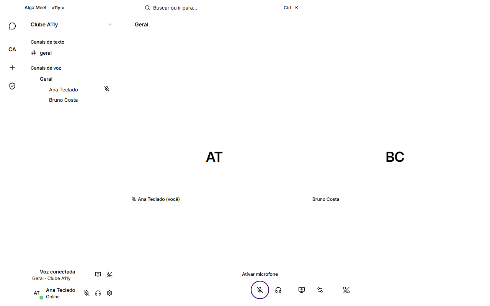
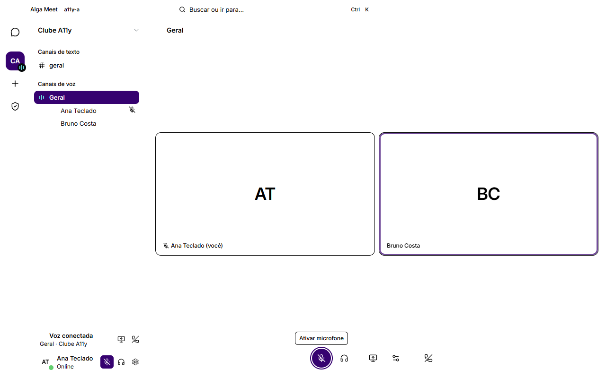
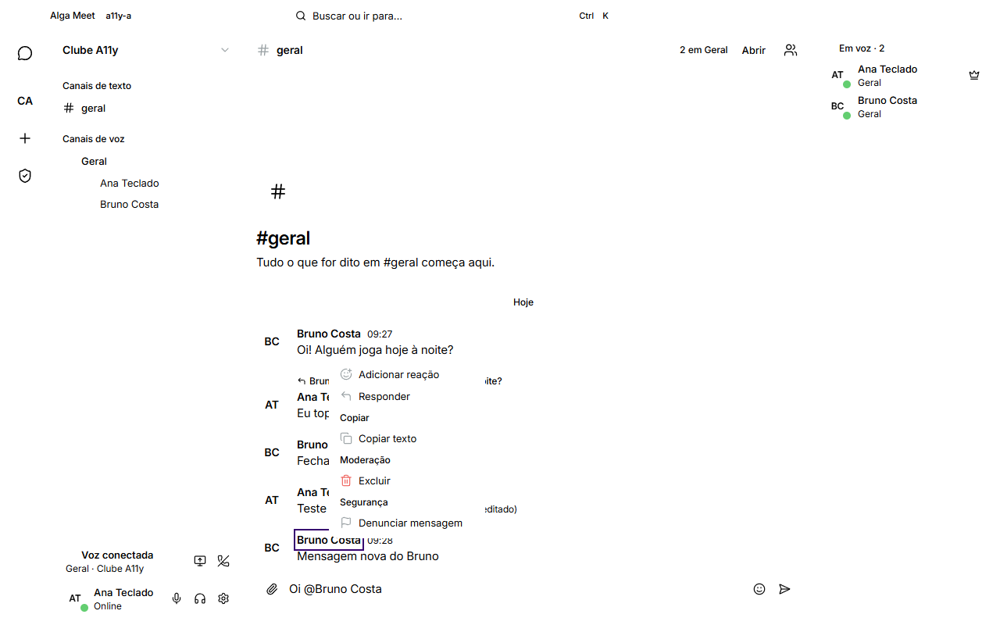
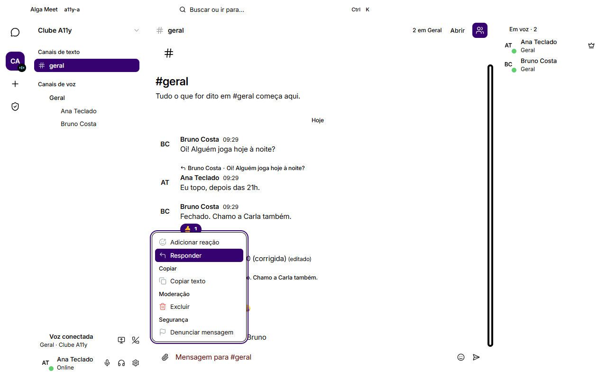

# Auditoria de acessibilidade — teclado, leitor de tela, alto contraste (2026-11-01)

> App real (Electron 45 + React 19, build de produção do renderer) dirigido pelo Playwright `_electron` contra uma API e um LiveKit próprios. Script: `apps/desktop/scripts/a11y-audit.mjs` (+ `a11y-page.mjs`, injetado na página). Dados brutos: `docs/accessibility/2026-11-01/before.json` e `after.json`. Regras de design que saem daqui: `docs/design/design-system.md` §6b.

## Resumo

- **Jornadas de teclado: 3/10 → 10/10.** Antes, o teclado parava em quase toda tela que tem menu ou popover: os painéis flutuantes nunca recebiam o foco, Shift+F10 numa mensagem não fazia nada, o histórico engolia dezenas de Tabs, o rail e a lista de canais não tinham setas, e o foco caía no `<body>` ao terminar uma edição, começar uma transmissão e sair da chamada.
- **Achados das regras: 31 → 1** (14 telas). O que sobra é uma exceção aceita (a busca do "Ir para", ver Pendências).
- **Regiões vivas: 2/5 → 5/5.** Toasts e entrada/saída na chamada não chegavam ao leitor de tela.
- **Alto contraste: 12 estados invisíveis → 0.** Switches, página atual, aba e opção selecionadas, segmented e fonte escolhida do seletor de tela sumiam. Nenhuma parada de Tab fica sem contorno.
- **Movimento reduzido já funcionava** (SO e "Reduzir animações"): o brilho de quem fala vira liga/desliga, a luz da sala apaga, nada fica animando. Nada mudou aqui.
- **Leitor de tela de verdade (NVDA/Narrador) ainda não foi testado.** O script prova que o nome existe e que o texto chega a uma região viva que já existia, não o que é falado.

## Como foi medido

- **Sem axe-core, sem dependência nova.** `a11y-page.mjs` roda dentro da página e checa, com estilos computados:
  - `name` — todo controle (botão, link, campo, `role` de widget, listbox, radiogroup, meter) visível e exposto tem nome acessível (accname simplificado: `aria-labelledby` > `aria-label` > `<label>` > conteúdo > `title`/placeholder). Elemento focável sem papel também conta.
  - `genericLabel` — `aria-label` em `div`/`span` sem `role` (ARIA 1.2 proíbe; o leitor ignora o nome).
  - `tabindex` — `tabindex` positivo. `hiddenFocus` — focável dentro de `aria-hidden`.
  - `focus` — caminhada de Tab real (teclado do Playwright): para cada parada, estilos com foco × sem foco no elemento, em dois ancestrais, no irmão seguinte e nos `::before/::after` (outline, box-shadow, fundo, borda, cor). Sem diferença = foco invisível. Transições desligadas durante a medição.
  - `dialog` — `role="dialog"` com nome; o que cobre ≥ 35 % da janela tem `aria-modal="true"`; com modal aberto o foco está dentro; camada fixa grande com controles e sem `role="dialog"`.
  - `menu` — `role="menu"` com nome, só filhos `menuitem*`/`separator`/`group`, itens com nome, foco dentro do menu aberto, `aria-activedescendant` válido, gatilho `aria-haspopup` com `aria-expanded`.
  - `img` — `` com `alt` (vazio = decorativa), `role="img"` com nome, `svg` exposto sem nome fora de um controle.
  - `contrast` — cada nó de texto visível (e cada placeholder): cor do texto × fundo **composto** (camadas translúcidas dos ancestrais sobre `--bg-app`, opacidade acumulada), cores convertidas para sRGB por um canvas 1×1 (aceita oklch, `color(srgb …)`, `color-mix`). AA: 4,5:1, ou 3:1 a partir de 24 px / 18,66 px negrito. Desabilitado é isento. Texto sobre gradiente, imagem ou vídeo é pulado e contado à parte (2 nós por tela no máximo). Auto-teste: `#767676` sobre branco = 4,54:1.
  - `live` — um `MutationObserver` registra todo texto que chega a uma região viva e marca se a região **já existia** antes do texto (ou é `role="alert"`). Região criada junto com o texto conta como não anunciada (NVDA e Narrador costumam pular).
  - movimento — `document.getAnimations()` em execução e 3 s de amostras de `--speak` nos tiles/avatares com alguém falando.
  - `forcedFocus` / `forcedState` — com `forcedColors: 'active'`: toda parada de Tab tem outline visível (box-shadow some em alto contraste); todo estado "atual/selecionado/pressionado/escolhido" é legível (≥ 3:1) e diferente de um item irmão não selecionado.
- **Jornadas só de teclado** (`page.keyboard`, nenhum clique): o estado inicial de cada jornada é preparado pelo script (ex.: foco no composer), a jornada em si é só teclado e cada passo verifica o resultado real (foco, `aria-pressed`, mensagem enviada, transmissão no ar).
- **Isolamento:** API própria na :4480 (PGlite em `%TEMP%\alga-a11y`), LiveKit na :7990 (tcp 7991, udp 51800–51899), build em `node_modules/.alga-a11y` (o "antes" em `node_modules/.alga-a11y-before`, gerado da árvore de trabalho antes de qualquer correção), perfis `a11y-a` (Ana, teclado) e `a11y-b` (Bruno, microfone falso com fala sintética). A transmissão de Ana usa captura real (sem `--use-fake-device-for-media-stream`) de duas janelinhas ffplay `A11Y-Share-*`, as únicas que o `desktopCapturer` lista; o microfone de Ana é um tom WebAudio. Tudo que o script inicia ele encerra. Nada tocou :4000/:7880 nem os perfis `default`/`bob`.
- "Antes" e "depois" rodaram com **o mesmo script** (versão final) contra os dois builds.

## Achados por regra

A contagem soma os achados distintos de todas as telas. No contraste, cada par de cores conta uma vez por tela. Telas auditadas:

- entrar, chat, menu da mensagem, emoji, perfil, "Ir para", denúncia;
- configurações (conta, voz, aparência), painel da equipe, amigos;
- chamada (2 pessoas, Bruno falando) e seletor de tela.

A caminhada de Tab rodou em entrar, chat, "Ir para", aparência, chamada e seletor.

| Regra | Antes | Depois | O que era |
|---|---|---|---|
| `name` (controle sem nome) | 0 | 0 | — |
| `genericLabel` (`aria-label` em div sem papel) | 10 | 0 | lista de membros (`div aria-label="Membros"`), em 10 telas |
| `tabindex` positivo | 0 | 0 | — |
| `hiddenFocus` | 0 | 0 | — |
| `dialog` | 0 | 0 | — |
| `menu` | 2 | 0 | menu da mensagem sem nome e aberto sem foco dentro |
| `img` | 0 | 0 | — |
| `contrast` | 3 | 0 | versão no login `#636a6e` sobre `#080b0c` 3,59:1; placeholder "Buscar emoji" `#757575` sobre `#2a2f31` 2,93:1; placeholder "Buscar" (amigos) 3,63:1 |
| `focus` (foco invisível) | 1 | 1 | busca do "Ir para" (exceção aceita) |
| `live` (anúncio que não chega) | 3 | 0 | toast; entrou na chamada; saiu da chamada |
| `forcedFocus` (sem contorno em alto contraste) | 0 | 0 | — (71 e 66 paradas medidas) |
| `forcedState` (estado invisível em alto contraste) | 12 | 0 | espaço atual no rail (4 telas), seção atual das configurações, aba, fonte escolhida, 5 segmented |
| **Total** | **31** | **1** | |
| **Jornadas** | **3/10** | **10/10** | |

No contraste, cada tela teve de 12 a 128 nós de texto checados. Texto sobre gradiente, imagem ou vídeo foi pulado: no máximo 2 nós por tela, o título da introdução do canal sobre o halo.

## O que estava errado e o que mudou

1. **Menus e popovers não recebiam o foco** (`ui/Menu.tsx`, `ui/Popover.tsx`). O `focus()` rodava no mesmo efeito que calcula a posição, com o painel ainda em `visibility: hidden`, e o Chromium recusa sem avisar. Efeitos:
   - nenhum menu aberto pelo teclado aceitava setas (↓ no gatilho só reabria o menu);
   - a busca de emoji não ficava focada, e o cartão de perfil e o status também não.

   Agora o foco vai depois de posicionado. Popover fechado por uma escolha devolve o foco ao gatilho.
2. **Menu de contexto pelo teclado** (`ui/Menu.tsx`, `features/chat/MessageList.tsx`).
   - A detecção "veio do teclado" esperava `clientX/Y = 0`. O Chromium manda Shift+F10/tecla Menu com `button = -1` e a posição do elemento focado, então o 1º item nunca ficava ativo.
   - Numa mensagem focada (a linha `role="article"`) nada abria: o handler ficava no filho, e o evento só sobe. Agora a lista repassa o evento ao filho.
   - Menus de contexto ganharam nome: "Ações da mensagem", o nome do canal. Sem nome passado, o menu usa o `aria-label` do gatilho.
3. **O histórico era um buraco de Tab** (`MessageList.tsx`). A mensagem itinerante existia, mas o Tab também passava pelo autor, pela citação e pela barra de ações de cada mensagem (a barra aparece com `:focus-within`): 40 Tabs não atravessavam a conversa. Agora o foco que chega de fora pousa na mensagem itinerante. Tab percorre os controles dela e sai da lista.
4. **Rail e lista de canais sem setas** (`arrowFocus` em `ui/floating.ts`, `SpaceRail.tsx`, `Sidebar.tsx`). ↑ ↓ Home End movem entre os controles. Um `MenuButton` dentro dessas listas (`data-arrow-nav`) não sequestra o ↓.
5. **Foco caindo no `<body>`.**
   - Fim da edição inline: o foco volta ao composer (`Composer.tsx`).
   - "Transmitir": o botão Compartilhar era trocado por outro elemento (Parar transmissão), e o modal não tinha para onde devolver o foco. Agora é o mesmo elemento nos dois estados (`MenuButton off` em `ControlsDock.tsx`; idem no painel "Voz conectada", `VoicePanel.tsx`).
   - Sair da chamada: o foco vai ao composer ou ao canal atual quando a chamada de fato termina (`VoicePanel.tsx`), ou ao botão Entrar do palco (`CallStage.tsx`).
   - Enter no canal que já está aberto: o foco vai ao composer (`Sidebar.tsx`).
6. **Fontes do seletor de tela** (`ScreenPicker.tsx`): eram rádios sem setas, todos no Tab. Agora são uma parada só, e as setas escolhem.
7. **Regiões vivas** (`ui/Toast.tsx`, `features/voice/VoiceAnnouncer.tsx` novo, montado no `Shell`).
   - Cada toast nascia como `role="status"` já com o texto. Agora a região "Notificações" é `aria-live="polite"` e existe antes do toast. Erro continua `role="alert"`.
   - Quem entra e sai da chamada em que você está (e a sua própria entrada e saída) é anunciado numa `role="status"` fixa.
   - O toast pausa também no foco, não só no hover.
8. **Lista de membros** (`MemberList.tsx`): virou `role="complementary"` "Membros", um landmark ao lado de "Canais". O `aria-label` num `div` era ignorado.
9. **Contraste** (`auth.module.css`, `styles/base.css`, `chat.module.css`):
   - a versão no login passou para `--text-tertiary`;
   - `::placeholder` global em `--text-tertiary`;
   - a busca de emoji mostra o foco na caixa (`:focus-within`).
10. **Alto contraste** (`styles/base.css`, `features/voice/stage.module.css`):
    - outline `Highlight` em todo `:focus-visible`;
    - atual, selecionado, pressionado, rádio escolhido e item ativo de menu em `Highlight`/`HighlightText`;
    - switch com borda, trilho e polegar;
    - borda `CanvasText` em menus, diálogos, tooltips e toasts;
    - tile com borda e contorno de fala `Highlight` (opacidade `--speak`); o medidor do microfone no dock também.

    O `!important` nos estados veio do próprio passe forced. Sem ele, a regra do componente (mais específica) devolvia a tinta, e o item selecionado ficava quase branco sobre branco. A regra `forcedState` pega isso agora.

## Jornadas de teclado

Só teclado (`page.keyboard`). Cada passo confere o resultado real.

| Jornada | Antes | Depois |
|---|---|---|
| J1 Entrar: foco inicial no login, Tab para a senha, Enter | passa | passa |
| J2 Rail com setas, abrir o espaço, lista de canais com ↑ ↓ Home, Enter em #geral leva ao composer | falha: ↓ não move no rail | passa |
| J3 Enviar; ↑ edita a última; Enter salva; ir à mensagem do Bruno; reagir 👍 e Responder pela barra de ações | falha: depois de salvar a edição o foco cai no `<body>` | passa |
| J4 `@bru` + Enter escolhe a menção; Tab até Emoji, Enter, buscar, Enter insere e volta ao composer; Esc devolve ao botão | falha: a busca de emoji não recebe o foco | passa |
| J5 Ctrl+K com a busca focada; Enter vai ao destino; Esc devolve o foco | passa | passa |
| J6 Lista até o canal de voz, Enter entra; mudo e ensurdecer (`aria-pressed`); Compartilhar tela; → em "Janelas"; → escolhe a 2ª janela; Transmitir; foco volta ao controle; parar pelo menu | falha: as setas não escolhem a janela (1) | passa |
| J7 Configurações, Aparência, Espaço em "Reduzir animações", Esc volta ao botão | passa | passa |
| J8 Shift+F10 numa mensagem (1º item ativo), Esc devolve; tecla Menu; Shift+F10 num membro, Esc devolve | falha: Shift+F10 na mensagem não abre menu | passa |
| J9 Menu da mensagem, Denunciar, escolher motivo, Esc volta à mensagem; painel da equipe pelo rail, Esc volta ao botão | falha: Shift+F10 na mensagem não abre menu | passa |
| J10 Nada aberto depois de Esc; Desconectar; o foco não cai no `<body>` | falha: foco no `<body>` | passa |

(1) Na 1ª medição do mesmo build, com Tab + Espaço no lugar das setas, o foco ainda caía no `<body>` depois de Transmitir.

Distâncias medidas depois:
- login até a senha: 1 Tab;
- composer até a lista de canais: 8 Shift+Tab;
- composer até Configurações: ~17 Tab (ver F6 em Pendências).

## Regiões vivas

| Evento | Antes | Depois |
|---|---|---|
| Bruno digitando | anunciado (`aria-live` fixo) | anunciado |
| Mensagem nova do Bruno | anunciado ("Bruno Costa: …" na `role=status` da lista) | anunciado |
| Toast ("Copiado") | não: `role=status` criada já com o texto | anunciado na região "Notificações" |
| Bruno entrou na chamada | não: nenhuma região recebe nada | "Bruno Costa entrou na chamada" |
| Bruno saiu da chamada | não | "Bruno Costa saiu da chamada" |

## Movimento reduzido

Cena: Ana e Bruno na chamada, Bruno falando (fala sintética). O script amostra `--speak` por 3 s em 10 elementos (tiles, avatares, frondes).

| Modo | Valores de `--speak` | Intermediários | Luz da sala (`.area::before`) | Animações rodando |
|---|---|---|---|---|
| Normal | 68 | 462 | visível | 0 |
| `prefers-reduced-motion: reduce` | 2 (0 e 1) | 0 | `display: none` | 0 |
| "Reduzir animações" ligado | 2 (0 e 1) | 0 | `display: none` | 0 |

O build de antes deu o mesmo resultado. O brilho de quem fala vira um indicador estático (liga/desliga) e nada continua em movimento. No modo normal também há 0 animações porque nada respira nessa cena: Ana está na sala, e as frondes seguem o envelope da voz, não a animação CSS.

## Alto contraste (forced colors)

Emulação do Playwright (`forcedColors: 'active'`, tema claro). Antes e depois:

| Tela | Antes | Depois |
|---|---|---|
| Configurações › Aparência |  |  |
| Seletor de tela (Janelas) |  |  |
| Chamada (mudo ligado, Bruno falando) |  |  |
| Chat com o menu da mensagem (Shift+F10) |  |  |

Antes, Aparência e o seletor eram inutilizáveis:
- os dois switches sumiam;
- não dava para saber o tamanho do texto, a densidade, a aba, a qualidade nem a janela escolhida;
- a seção atual das configurações e o espaço atual no rail não apareciam;
- no chat, o menu aberto pelo teclado a partir do nome do autor flutuava sem borda sobre as mensagens, sem item ativo e sem o foco dentro.

Depois:
- os estados aparecem em `Highlight`;
- os switches têm trilho e polegar;
- o tile tem borda e contorno de fala;
- todas as paradas de Tab têm contorno de foco (chat 25, chamada 23, aparência 18).

## Pendências

1. **Teste manual com NVDA e Narrador: pendente.** Nada aqui foi ouvido. Falta conferir:
   - a ordem e a verbosidade da leitura de uma mensagem (autor, hora, citação, reações);
   - o cursor virtual no histórico virtualizado: só as linhas montadas existem no DOM, cerca de 900 px além da tela;
   - a fala dos menus com `aria-activedescendant`;
   - os anúncios novos (toast, entrou/saiu da chamada);
   - o seletor de tela.
2. **Mudo/ensurdecer: o nome muda e o `aria-pressed` também.** Pressionado, o botão se chama "Ativar microfone", e o leitor diz "Ativar microfone, pressionado".
   - O certo: nome fixo ("Desativar microfone") com `aria-pressed`, e a tooltip dizendo a próxima ação.
   - Não apliquei porque `scripts/qa-journey.mjs` e `scripts/screenshot.mjs` (fora do meu escopo) localizam esses botões por "Ativar microfone"/"Ativar áudio".
   - A mudança é pequena: `CallButton` em `ControlsDock.tsx`, `UserPanel.tsx` e uma prop `tooltip` no `IconButton`. Precisa ir junto com os dois scripts.
3. **A busca do "Ir para" não tem indicador de foco além do cursor.** É o único controle do diálogo, está sempre focada e em alto contraste ganha o outline. Ficou como exceção aceita: é o único achado do "depois".
4. **Popover não é modal, e o Tab sai dele sem fechá-lo** (perfil, emoji, status, volume do participante). Esc e clique fora fecham. Avaliar fechar no `focusout`.
5. **As abas do seletor de tela não têm `tabpanel`/`aria-controls`.**
6. **Não há atalho entre regiões.** São ~17 Tabs da conversa até Configurações. Um F6 alternando rail, canais, conversa e membros resolveria.
7. **Alto contraste só foi visto na emulação clara do Playwright.** Faltam os temas escuros do Windows (Aquático, Noite, Deserto) e um Windows real com alto contraste ligado. Miniaturas, avatares com foto e emojis mantêm as cores próprias.
8. **Cobertura.** Ficaram fora da auditoria por regras:
   - cadastro e verificação de e-mail;
   - configurações do espaço (cargos, membros, convites), loja/assinatura e privacidade;
   - lightbox, mini player, chamada recebida e chamada em DM.

   As cores de cargo não apareceram na fixture. Os tokens dizem ≥ 4,5:1, mas isso não foi medido.
9. **Motor de mídia (`src/renderer/src/media`): nada bloqueia.** Sugestão para o engenheiro de mídia: um evento de "falante ativo" com histerese (≥ 1 s). Serviria para um anúncio opcional de quem está falando e para o palco dizer isso em texto; hoje só o brilho mostra.

## Como rodar de novo

```
cd apps/desktop
node scripts/a11y-audit.mjs                       # build próprio + todos os passes → docs/accessibility/2026-11-01/after.json
node scripts/a11y-audit.mjs --skip-build --only=forced,motion
node scripts/a11y-audit.mjs --app=node_modules/.alga-a11y-before --label=before   # outro build já pronto
```
Precisa de `ffmpeg`/`ffplay` no PATH e do LiveKit em `infra/livekit/bin`. Abre duas janelas do app e duas janelinhas de padrão de teste na área de trabalho por ~10 min.
