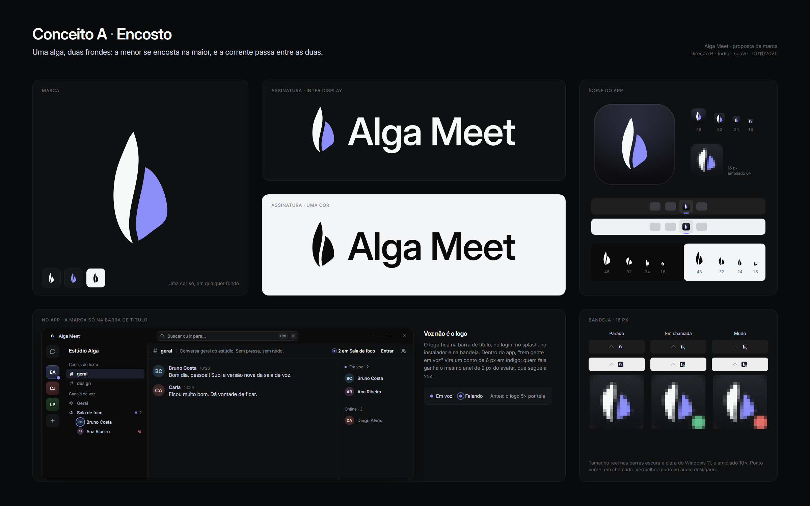
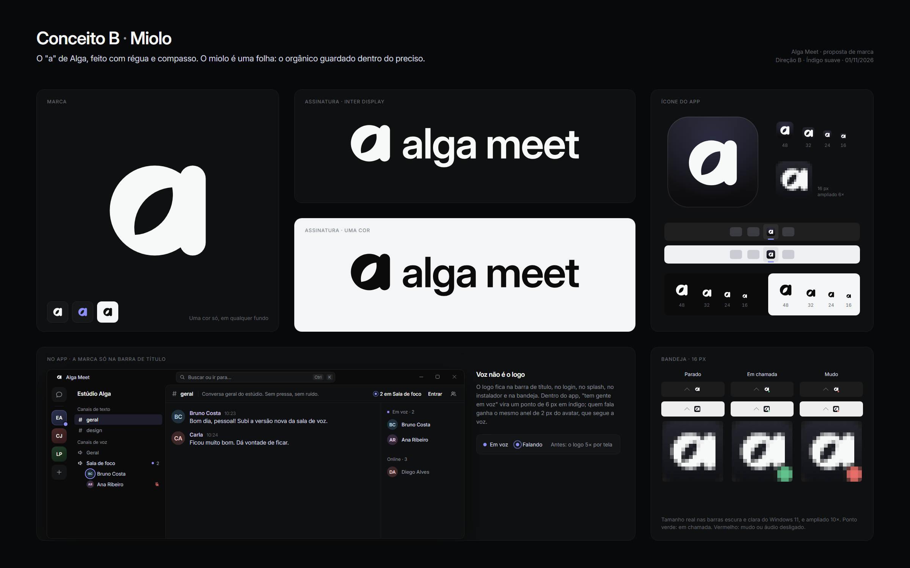
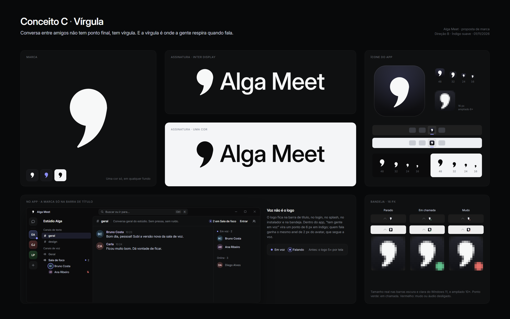

# Marca: três conceitos para escolha

> Proposta de 01/11/2026 para o dono escolher. Nada no produto mudou: `apps/desktop/build/**`, o app e os ativos continuam com a marca v2 (as três barras).
> Ponto de partida: problema 3 da crítica r3 (`docs/design/critique-2026-11-01-r3.md`). As três barras leem como o ícone universal de áudio, e o mesmo glifo aparece 5 vezes por tela como sinal de "tem gente em voz".

Cada folha (2400 × 1500) mostra:

- a marca grande;
- a assinatura no escuro e no claro;
- o ícone do app em 256, 48, 32, 24 e 16 px, e na barra de tarefas escura e clara do Windows 11;
- o glifo solto em 48/32/24/16 px;
- a bandeja nos estados parado, em chamada e mudo, em 16 px reais e ampliada;
- a barra de título e o rail do app usando a marca, com o novo sinal de voz.

| Conceito | Folha | Arquivos |
|---|---|---|
| A · Encosto | [`concept-a.png`](concept-a.png) | `concept-a-*.svg` |
| B · Miolo | [`concept-b.png`](concept-b.png) | `concept-b-*.svg` |
| C · Vírgula | [`concept-c.png`](concept-c.png) | `concept-c-*.svg` |

Os SVGs de cada conceito:

| Arquivo | O que é |
|---|---|
| `-mark.svg` | Marca, grade 256, uma cor (`currentColor`). Usada de 24 px para cima. |
| `-mark-16.svg` | Mestre de 16 px desenhado na grade de pixel (serve a 16 e a 32). |
| `-icon.svg` | Ícone do app (40 px ou mais). |
| `-icon-16.svg` | Ícone do app, mestre de 16 px. |
| `-lockup.svg` | Assinatura horizontal, uma cor. O texto é Inter Display convertida em curvas, então abre igual em qualquer máquina. |

---

## A · Encosto

**A ideia.** Uma alga, duas frondes. A menor se encosta na maior, e a corrente passa entre as duas.

**Por que serve à Alga Meet.**

- É o único dos três que é dono do nome. Tem alga sem cair no clip-art.
- O "Meet" aparece sem ícone de pessoa: são duas presenças de tamanhos diferentes, juntas.
- O branco e o índigo viram um sistema: você e quem está com você.
- Só tem curvas macias e nenhum ângulo. Em tamanho grande, é o mais "gostoso" dos três.

**Riscos.**

- Pode ser lida como chama: branco com azul lembra a chama do fogão. Também pode parecer a folha genérica dos selos "eco".
- É o mais frágil em 16 px. O glifo ocupa só 8 dos 16 px de largura, e a fronde branca fica com 2 a 3 px.
- Em uma cor só (instalador, impressão, carimbo), as duas frondes se separam apenas pelo vão.
- Antes de virar produto, pede mais uma rodada de desenho pixel a pixel em 16, 20 e 24 px.

## B · Miolo

**A ideia.** O "a" de Alga feito com régua e compasso, um círculo e uma haste. O miolo é uma folha: o orgânico guardado dentro do preciso.

**Por que serve à Alga Meet.**

- É o mais próximo da contenção da Linear: geometria exata, uma cor, nenhum efeito.
- É o mais legível em 16 px. A haste tem 3 px em pixel inteiro, e o miolo tem 3 px e não fecha.
- Funciona como favicon, avatar do app e selo.
- A assinatura em minúsculas ("alga meet") soa calma e próxima.

**Riscos.**

- Monograma de letra é a categoria mais disputada. Entre 16 e 24 px a folha some e sobra "um a", parecido com outros apps.
- É o menos emocional dos três: elegante, mas não diz nada sobre voz ou encontro.
- O "a" da marca tem um andar e o da Inter tem dois, e na assinatura os dois convivem. É uma escolha consciente, mas há quem estranhe.

## C · Vírgula

**A ideia.** Conversa entre amigos não tem ponto final, tem vírgula. E a vírgula é onde a gente respira quando fala.

**Por que serve à Alga Meet.**

- Fala de voz sem onda, sem fone e sem balão.
- Tem a silhueta mais forte dos três: uma cabeça redonda e um rabo curto. Lê igual em 256 e em 16 px, na barra de tarefas escura e na clara.
- Ninguém na categoria (Discord, Slack, Teams, WhatsApp) tem nada parecido.
- Cabe numa frase em português que qualquer pessoa repete.
- Conversa com retenção: a conversa continua amanhã.
- É uma forma e uma cor. É a calma da Direção B.

**Riscos.**

- Pontuação puxa para texto e escrita, e o produto é voz primeiro. No começo, a frase precisa andar junto com a marca: no login, no splash e no site.
- Pode ser lida como apóstrofo, aspas ou "9", principalmente em uma cor ou girada.
- Não tem nada de "alga". Essa parte fica por conta do nome e das coleções (Hora Azul).

---

## O sinal de voz (vale para os três)

O logo deixa de ser sinal de status. Ele fica na barra de título, no login, no splash, no instalador, na bandeja e nas notificações.

Dentro do app, "tem gente em voz" vira um sinal próprio:

- **Em voz:** ponto de 6 px em `--accent` (`#8b8ef7`).
  - No rail: no canto inferior direito do espaço, com anel de 2 px da cor do fundo.
  - Na sidebar: à direita do canal, com a contagem ("● 2").
  - No header: "● 2 em Sala de foco".
  - Na lista de membros: "● Em voz · 2".
- **Falando:** um anel de 1,5 px, 3 px fora do ponto, com a opacidade seguindo o envelope (`useEnvelope`). É a mesma linguagem do anel de 2 px do avatar. Com movimento reduzido, o anel só aparece e some.
- **No print do chat:** o logo sai das 5 posições onde aparecia, e o sinal fica só onde há informação.

## Teste em 16 px (autocrítica)

Ampliei recortes das próprias folhas em 1:1 (barra de título, barra de tarefas, glifo solto, bandeja), sem nenhum reescalonamento vetorial.

- **B** é o mais seguro. Lê "a" em 16 px no escuro e no claro. O miolo vira uma mancha, mas não fecha.
- **C** lê como vírgula no ícone de 16 px. Solto em 16 px, sem o fundo, o rabo só sobrevive porque o mestre de 16 px tem o rabo mais grosso que o do mestre grande (base de 1,42 raio em vez de 1,24).
- **A** falhou na primeira passada: a fronde branca virou um fio de 1 px.
  - O mestre de 16 px foi redesenhado com frondes mais largas (3 e 4 px) e um vão de 1,6 px.
  - Agora lê como "duas formas", mas continua o mais frágil.
  - O índigo tem menos contraste que o branco no fundo escuro.
  - Em 24 px, que usa o mestre grande, a fronde branca ainda fica fina.
- **Nos três**, o ponto de estado da bandeja (4 px, com recorte transparente) é o mesmo do pipeline atual e funciona.

## Recomendação

**C · Vírgula.** A segunda opção é A.

O problema da marca atual é ser genérica e virar ícone de status. A vírgula é a mais distinta da categoria e só perde para B em 16 px. Também é a única cuja ideia cabe numa frase que o dono pode dizer a qualquer pessoa. E é calma, uma forma só, com uma curva que dá gosto de ver.

Se o dono quiser que a marca diga "alga" ao pé da letra, a escolha é A. Antes, A precisa de:

- mais uma rodada de desenho em 16, 20 e 24 px;
- um teste rápido de leitura com 5 pessoas: veem alga ou veem chama?

B é a escolha de menor risco, para quem prefere segurança a ser lembrado.

**Antes de adotar qualquer um:** fazer uma busca de anterioridade no INPI (classes 9, 38 e 42).

## Se um for escolhido

1. Desenhar os mestres `mark.svg`, `mark-16.svg`, `mark-20.svg` e `mark-24.svg` em `apps/desktop/build/brand/`, na mesma regra de hoje: pixel inteiro nos mestres pequenos, escala só por fator inteiro. O `scripts/brand.mjs` não precisa mudar: ele já rasteriza por mestre e monta a bandeja a partir de `tray.svg`.
2. No app:
   - `LogoMark` passa a desenhar o novo glifo.
   - `Fronds` sai do papel de logo.
   - O sinal de voz vira o ponto descrito acima.
3. Atualizar `apps/desktop/build/README.md` e o `design-system.md` (§3, "Frondes = a marca").
4. Revisar em 100 %, 125 % e 150 %, nas barras de tarefas escura e clara.

## Como foi feito

- **Geometria:** só preenchimentos (curvas Bézier e arcos, nenhum traço), então todo mestre é um glifo de uma cor.
- **Assinatura:**
  - Inter Display, que é a Inter Variable embarcada no app com o eixo `opsz` em 32.
  - Pesos: 560 (A), 600 (B) e 540 (C).
  - Tracking: −0,018, −0,026 e −0,016 em.
  - Convertida em curvas com fontTools, com o kerning da própria fonte. A Inter é SIL OFL e permite isso.
- **Folhas:** renderizadas no Chromium headless do Playwright de `apps/desktop`, em DPR 1.
- **Scripts:** os geradores ficaram fora do repositório. Os SVGs desta pasta são a fonte.
